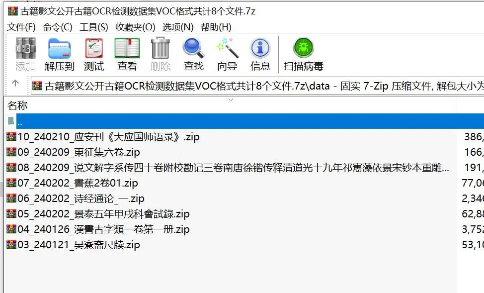

# Traditional Chinese Text OCR Public Dataset in VOC format, totaling 8 files

With the deepening of digital humanities research, utilizing artificial intelligence technology to automate the processing and intelligent analysis of ancient books and documents has become an important direction.

As digital humanities research deepens, utilizing artificial intelligence technology for the automated processing and intelligent analysis of ancient texts has become a significant direction. Among these, optical character recognition (OCR) of ancient books is the core component, and high-quality datasets are the foundation for training and evaluating OCR models. Among various data labeling formats, VOC (Visual Object Classes) format is widely adopted due to its clear structure and rich information in early computer vision tasks, and it is also suitable for the construction of ancient book OCR datasets.

**I. Format Overview**

VOC format is a classic and XML-based file structure used for storing annotation information of objects in images. For the task of ancient text OCR, its core is to treat each character or text line in an image as an "object" that needs to be detected and recognized.

**II. Core File Structure**

A typical VOC format ancient book dataset includes the following directory:

- `JPEGImages/`

Store all the ancient book photocopy image files (such as .jpg, .png).

- `Annotations/`

Stores XML annotations corresponding to each image.

**III. Annotation File (XML) Details**

Each XML file describes the information of all text areas in the corresponding image, mainly including the following key segments:

1. `**<filename>**`

: The corresponding image file name.

1. `**<size>**`

: The size information of the image, including width (<width>), height (<height>) and number of channels (<depth>).

1. `**<object>**`

: Each detected text or text line is a `<object>`. A single image typically contains many such tags.

- `**<name>**`

: The category of the text object. In ancient book OCR, this is usually the characters themselves (such as "Tian", "Di", "Xuan", "Huang") or a predefined category ID.

- `**<bndbox>**`

: Define the bounding box of a text area (Bounding Box) by precisely specifying the coordinates of the top-left corner (`<xmin>`, `<ymin>`) and the bottom-right corner (`<xmax>`, `<ymax>`). This is key to accurately positioning text.

- **(optional)** `<difficult>`

Mark the target as being difficult to recognize, such as when text is blurred, incomplete, or entangled.

**IV. Application and Significance of OCR in Ancient Texts**

Building a VOC-formatted ancient book OCR dataset, which has significant advantages:

- **Integration of Positioning and Identification**

It not only records the category of text (`<name>`), but also precisely records its position in the image (`<bndbox>`, very suitable for end-to-end text detection and recognition tasks.

- **Universality**

Mainstream deep learning frameworks (such as PaddleOCR, MMOCR) support converting VOC format to the format required for model training (such as COCO, txt, etc.).

- **Information complete**

The XML structure can accommodate rich metadata, providing potential for subsequent layout analysis, font research and other extended tasks.

**Summary**

The VOC format provides a structured and standardized annotation scheme for the digital organization of ancient book images. By systematically recording the position and content information of text in ancient books in XML format, it greatly facilitates the development and optimization of ancient book OCR models, serving as an important bridge connecting precious ancient book heritage with modern artificial intelligence technology.

Dataset screenshot:

## Payment

Here is a pay link on Stripe ( https://buy.stripe.com/3cs8yP7sY87d0vu9AB ). Please contact me lonlonago@foxmail.com after funding $89, and I will send you a complete data files , thank you!

